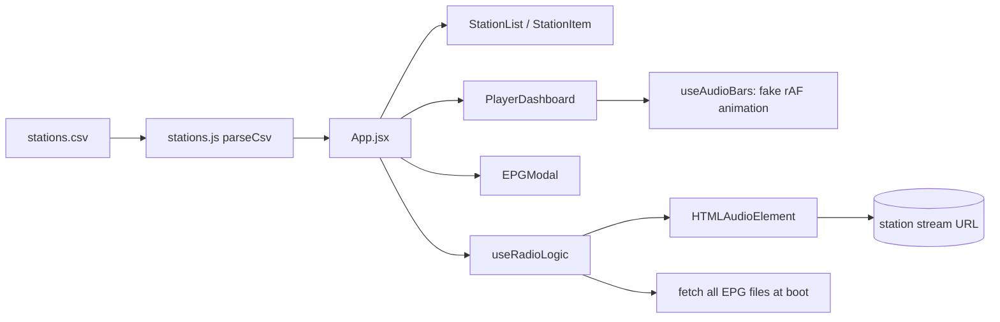
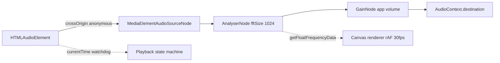
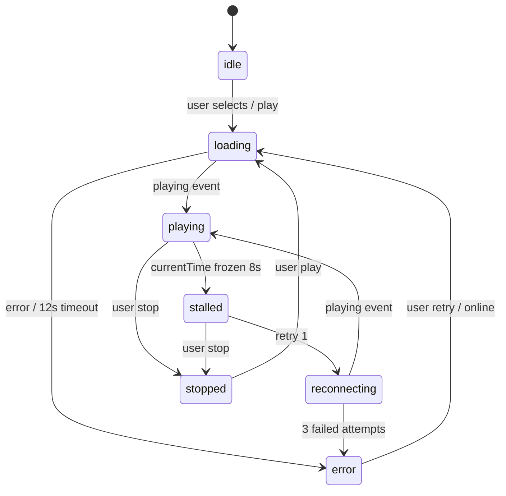
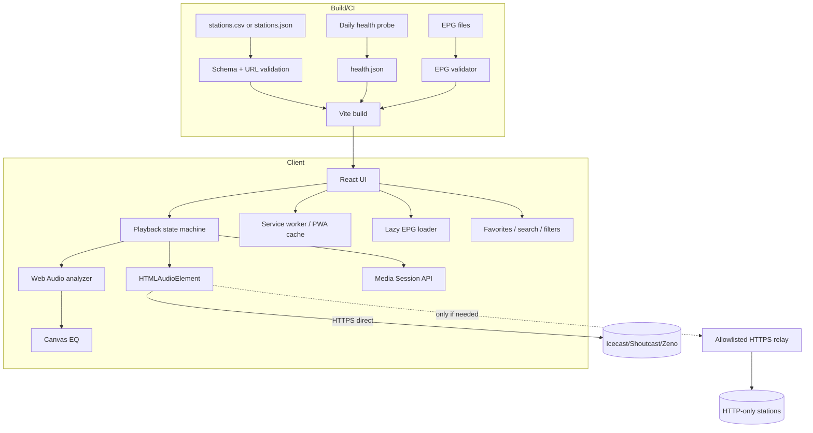
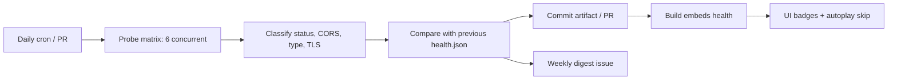

# RIOTSRADIOS — Scale-Up & Reliability Report

**Project:** RadIOT / RIOTSRADIOS (`riotsradios` v1.2.0)
**Report date:** 2026-10-18
**Scope:** stream reliability, HTTP/mixed-content handling, sound visualization, playback robustness, catalog quality, EPG, performance, TV/large-screen upscale, accessibility, security and engineering process.
**Status:** analysis + proposal. **No application code was modified by this report.**

---

## Table of contents

1. [Executive summary](#1-executive-summary)
2. [Method and evidence](#2-method-and-evidence)
3. [Current state at a glance](#3-current-state-at-a-glance)
4. [Findings: P0 (breaks the core experience)](#4-findings-p0-breaks-the-core-experience)
   - 4.1 [HTTP streams are blocked on the HTTPS deployment](#41-http-streams-are-blocked-on-the-https-deployment)
   - 4.2 [The spectrum analyzer is simulated, not responsive](#42-the-spectrum-analyzer-is-simulated-not-responsive)
   - 4.3 [Playback state is optimistic and never recovers](#43-playback-state-is-optimistic-and-never-recovers)
5. [Findings: P1 (trust, data and correctness)](#5-findings-p1-trust-data-and-correctness)
   - 5.1 [Catalog data quality and the phantom station](#51-catalog-data-quality-and-the-phantom-station)
   - 5.2 [Stream health is manual; no automated probing](#52-stream-health-is-manual-no-automated-probing)
   - 5.3 [EPG coverage and correctness](#53-epg-coverage-and-correctness)
   - 5.4 [Large-screen and Android TV layout is not upscaled](#54-large-screen-and-android-tv-layout-is-not-upscaled)
6. [Findings: P2 (performance, accessibility, security, process)](#6-findings-p2-performance-accessibility-security-process)
   - 6.1 [Payload and rendering performance](#61-payload-and-rendering-performance)
   - 6.2 [Accessibility and remote-control UX](#62-accessibility-and-remote-control-ux)
   - 6.3 [Security and privacy](#63-security-and-privacy)
   - 6.4 [Engineering hygiene](#64-engineering-hygiene)
7. [Upscale plan](#7-upscale-plan)
   - 7.1 [Target architecture](#71-target-architecture)
   - 7.2 [Real audio spectrum: design specification](#72-real-audio-spectrum-design-specification)
   - 7.3 [HTTP stream strategy: options and recommendation](#73-http-stream-strategy-options-and-recommendation)
   - 7.4 [Station data model v3](#74-station-data-model-v3)
   - 7.5 [Automated stream-health pipeline](#75-automated-stream-health-pipeline)
   - 7.6 [Playback state machine and reconnect policy](#76-playback-state-machine-and-reconnect-policy)
   - 7.7 [Growth features for scaling the product](#77-growth-features-for-scaling-the-product)
   - 7.8 [Performance budgets](#78-performance-budgets)
   - 7.9 [Testing strategy](#79-testing-strategy)
8. [Roadmap and effort](#8-roadmap-and-effort)
9. [Success metrics](#9-success-metrics)
10. [Risks and decisions needed](#10-risks-and-decisions-needed)
11. [Appendices](#11-appendices)

---

## 1. Executive summary

RIOTSRADIOS works, but two structural problems are visible in the current code and data:

1. **Stream availability is fragile and partly self-inflicted.** Of 58 catalog rows, 45 are marked active. A live probe on 2026-10-18 found only **33 producing audio**, and 3 of those are `http://` streams that **cannot play on the HTTPS GitHub Pages deployment** because browsers block mixed content. That leaves roughly **30 usable stations in production (~67% of the active catalog)**. Ten active stations return 4xx/5xx, HTML pages, an MP3 news clip, or an authentication challenge. Thirteen more are already hidden manually. The catalog has no automated health check, no HTTPS mirror field, and no fallback.
2. **The spectrum analyzer is knowingly cosmetic and is the reason it feels “not responsive.”** `useAudioBars` never touches the Web Audio API or the `<audio>` element; it animates a fixed mathematical envelope derived from `volume` and `stationIndex` (`comp/PlayerDashboard.jsx:3-63`). It cannot react to music, and it keeps moving when the stream is stalled, silent, or blocked. Even a correct analyzer would only work for stations that send CORS headers: **23 of 33 currently playable streams are CORS-capable (70%)**; the other 10 would produce silence in a naive implementation.
3. **Playback state is not event-driven.** There is no handling for `waiting`, `stalled`, `playing`, `ended`, or OS-level media controls. “LIVE” is shown as soon as `play()` resolves, and a stalled stream is never detected or reconnected. Stopping sets `audio.src = ''`, which can itself fire an error (`logic.js:262`).
4. **The catalog parser creates a phantom station.** The embedded newline in Radio Roja's quoted URL (`stations.csv`, station ID 45) splits the row in `parseCsv` (`stations.js:4`), producing 59 parsed rows and a blank, unclickable-but-selectable 46th entry with `id: NaN`.
5. **The product is not scaled for the living room it targets.** The app is capped at **520 px wide (600 px at ≥768 px)** (`styles.css:87`, `1849`). On a 1080p or 4K Android TV it renders as a narrow phone column with 16 px text, no safe-area handling, and no focus model for D-pads.

**Recommended order of work:** fix catalog/playback correctness and the visualizer's honesty first (days), then add a real analyzer + health pipeline (weeks), then decide the HTTP strategy (HTTPS mirrors first, allowlisted relay second), then upscale the TV layout, PWA/media-session features and EPG coverage.

---

## 2. Method and evidence

**Static review** of:

- `App.jsx`, `logic.js`, `comp/PlayerDashboard.jsx`, `comp/StationList.jsx`, `comp/StationItem.jsx`, `comp/EPGModal.jsx`
- `stations.js`, `stations.csv`, `public/EPGs/*.json`, `scripts/validate-epgs.js`
- `styles.css`, `index.html`, `vite.config.js`, `package.json`, `README.md`, `docs/EPG-FORMAT.md`
- `dist/` and the production build output

**Live probes** on 2026-10-18 from a Linux host:

- Each active URL was requested with `curl -L --max-redirs 3 -m 12`, sending `Origin: https://mrhumildad.github.io` and `Range: bytes=0-1`.
- Recorded: final HTTP status, `Content-Type`, `Access-Control-Allow-Origin`, TLS/connection errors.
- Probes were sequential in batches of six; stream servers were allowed 12 s to respond.
- CSV parsing for the probe replicated the app's logic and also a strict quoted-field parser, to compare behavior.

**Limitations**

- No real browser playback, no Android TV device, no audio output was tested. CORS was inferred from response headers, not from `MediaElementAudioSourceNode` behavior in each browser.
- Availability changes constantly. Re-run the probe before acting on a specific station.
- A server may vary by region, user agent, or time (Radio Ciroma returned `audio/mpeg` in one pass and `text/html` in another; it is flagged as intermittent).
- TLS validation was done by curl's CA bundle; Chrome/Firefox may behave differently for the incomplete-chain case.

---

## 3. Current state at a glance

| Metric | Value | Source |
|---|---:|---|
| CSV rows (excluding header) | 58 | `stations.csv` |
| Parsed rows in the app | 59 | `stations.js` parser |
| Rendered list entries | 46 | 45 real + 1 phantom `NaN` row |
| Marked `stream_broken` | 13 | `stations.csv` |
| Active stations (not marked broken) | 45 | parser filter |
| Probe-playable (audio response) | 33 | live probe |
| Playable on HTTPS deployment | ≈30 | 3 HTTP streams blocked |
| Intermittent / TLS issues | 2 | Ciroma, Irola Irratia |
| Active but unusable | 10 | 4xx/5xx/HTML/clip/auth |
| Active `http://` streams (mixed content) | 3 | Radiofabrik, Ahijuna, Zoy Milton |
| Broken-but-HTTP stations recoverable with a relay | 7 | see Appendix B |
| Streams with `ACAO: *` | 16 playable (17 probed incl. a 503) | live probe |
| Streams echoing the page origin | 7 playable | live probe |
| Playable streams with **no** CORS | 10 | real analyzer impossible without proxy |
| Stations with EPG | 3 of 45 (6.7%) | `epg_file` |
| Production JS | 225 KB (72 KB gzip) | `vite build` |
| Production CSS | 32 KB (6.7 KB gzip) | `vite build` |
| `dist/` total | 9.1 MB | `du -sh dist` |
| Splash GIF | 954 KB, 5 s overlay | `public/logo_flicker_loop.gif`, `styles.css:1899` |
| Unused public images | ~7.2 MB | see §6.1 |
| Tests / lint / typecheck | none | `package.json` |
| `dist/` committed | yes, while `.gitignore` lists `/dist` | git |

**Today's user-visible equation:** 45 stations look available, about 30 actually play in production, 23 of the playable ones could support a real analyzer, and 0 currently show real audio.

### Architecture as it exists



There is no service worker, no runtime health data, no cache, no proxy, no Web Audio graph, and no persistent user state.

---

## 4. Findings: P0 (breaks the core experience)

### 4.1 HTTP streams are blocked on the HTTPS deployment

#### Symptom

Some stations “work on my machine” during `npm run dev` (often `http://localhost`, or the browser allows the request) but fail on `https://mrhumildad.github.io/riotsradios/` with the display `STREAM ERROR (HTTPS)`. Others are simply absent because they were marked broken.

#### Root cause

Browsers treat media as **blockable mixed content**: an `https://` page may not load an `http://` audio resource. There is no user-facing “load anyway” prompt. This is enforced before the network request, so the station server is irrelevant.

Current detection (`logic.js:194-203`, `267-274`) is correct in principle but incomplete:

- It only runs on `selectStation` and `togglePlay`, not when the list renders, so those stations still look playable.
- It assumes `window.location.protocol === 'https:'`. `file://`, custom schemes, and some WebViews don't match that string.
- It stores a generic `mixed-content` error. The UI says `STREAM ERROR (HTTPS)` with no explanation, no station URL, and no recovery path.
- The server-side reality is never distinguished from a dead stream.
- There is no `https_url`/mirror field to try instead.

#### Evidence

| ID | Station | URL | Probe | Why it fails in production |
|---:|---|---|---|---|
| 8 | Radiofabrik | `http://stream.radiofabrik.at/rf_low.mp3` | 200 `audio/mpeg`, `ACAO: *` | Mixed content on HTTPS |
| 65 | Ahijuna | `http://stream.ahijuna.fm/aire.ogg` | 200 `application/ogg`, `ACAO: *` | Mixed content on HTTPS |
| 71 | Zoy Milton | `http://icepool.silvacast.com/GAYFM.mp3` | 200 `audio/mpeg`, origin echo | Mixed content on HTTPS |

Seven additional stations already marked broken are HTTP and could potentially be recovered the same way: IDs 14, 15, 17, 20, 42, 60, 73 (Appendix B). ID 35 is `espora.org:8000/laboratorio` — not even a valid URL scheme.

#### Impact

- Three listenable stations are silently lost in the deployed app.
- Users cannot tell “station is down” from “browser refuses to load it.”
- Any future HTTP station added to the CSV will fail in production unless someone remembers to hide it.
- The same restriction applies to an Android TV WebView/Electron shell unless explicitly configured.

#### What does **not** fix it

- `upgrade-insecure-requests` CSP: it rewrites `http://` to `https://`, but these servers generally have no TLS on that host/port, so the stream still fails.
- Fetching the stream with `fetch()` first: the media element still loads it as mixed content.
- Service-worker proxying of cross-origin HTTP: a service worker cannot bypass mixed-content blocking for media.

#### Fix options

| Option | User result | Effort | Cost / risk | Verdict |
|---|---|---|---|---|
| **Find an HTTPS mirror** per station (provider API, station site, alternate mount) | Direct playback, no proxy | 0.5–2 days per batch | Requires contacting stations; mirror can disappear | **Do first** |
| **Allowlisted edge relay** (Cloudflare Worker / Deno Deploy / small VPS) that re-streams the audio over HTTPS and adds CORS | Playback + real analyzer for all relayed stations | 2–5 days | Bandwidth/abuse/legal; station permission; must prevent SSRF; adds a dependency | **Recommended fallback** |
| **Native wrapper** (Capacitor/Electron/Android TV WebView) with mixed content allowed for specific hosts | Works, but only in the wrapper | 1–3 weeks | App-store/TV packaging, duplicate distribution | Only if native becomes a goal |
| **Hide/mark unavailable** on HTTPS with a clear “opens on station site” link | Honest but lost playback | 0.5 day | None | Minimum acceptable |
| **External player handoff** (`intent://`, VLC) | Works on some Android devices | 1–3 days | Unreliable in browsers; bad TV UX | Not a web solution |

#### Recommendation

1. Add `https_url` (nullable) to the catalog and try it automatically before declaring an error.
2. For the 3 current HTTP stations, request an HTTPS mount. Radiofabrik and Ahijuna are community stations likely to cooperate.
3. If no mirror exists, run a **small allowlisted relay** keyed by station ID, never by an arbitrary URL parameter. Requirements:
   - `GET`/`HEAD`, pass through `Content-Type`, `icy-*`, and `Range`.
   - `Access-Control-Allow-Origin: https://mrhumildad.github.io` (or `*`), `Cache-Control: no-store`.
   - Allowlist destination hosts; block private IPs and redirects to private ranges.
   - 15 s upstream timeout, abort on client disconnect, no request logging of IPs, per-IP concurrency limit.
   - Send a descriptive `User-Agent` and ask each station for permission. Do not proxy all stations by default; only the HTTP/insecure ones.
4. Until a mirror/relay exists, show a precise error: “This station only broadcasts over HTTP. Open station site” with a link, and keep it out of autoplay rotation.

#### Acceptance criteria

- On the HTTPS build, every active station either starts playing or shows one of: `OFFLINE`, `HTTP_ONLY`, `CORS_BLOCKED`, `FORMAT_UNSUPPORTED`, `AUTH_REQUIRED`, `STALLED`.
- Zero unexplained generic “STREAM ERROR (HTTPS)”.
- A CI check fails the build if an active station has `http://` and no `https_url`/`relay` flag.
- The relay is allowlisted and covered by tests for SSRF and redirect abuse.

---

### 4.2 The spectrum analyzer is simulated, not responsive

#### Symptom

The bars move slowly, do not follow the music, and keep moving during silence, buffering, or a dead stream. On low-end TVs the UI can also stutter while the bars animate.

#### Root cause (code-level)

`useAudioBars` is explicitly documented as cosmetic:

> “Purely cosmetic spectrum ticker that reacts to isPlaying, volume and stationIndex, but never touches the Web Audio API or the `<audio>` element. Cannot break audio playback under any condition.”
> — `comp/PlayerDashboard.jsx:3-9`

The level formula (`PlayerDashboard.jsx:36-42`) is:

```js
const noise = ((i * 27182.718) % 1)
const foo   = (noise + wave * 0.00314 + seed) % 1
const shape = Math.exp(-(i / 23) * 1.5)
return Math.max(0, (foo * 0.25 + shape * 0.75) * v)
```

`noise` is constant per bar; `wave` advances by `0.072` per frame. The result is a slow sawtooth sweep, not audio. It is multiplied by volume, so moving the volume slider appears to “change” the visualization.

The bars are updated through React state at up to 60 fps:

```js
setBars(prev => prev.map((val, i) => val + (next[i] - val) * 0.30))
rafIdRef.current = requestAnimationFrame(step)   // PlayerDashboard.jsx:45-46
```

Each `SoundBar` renders 12 segments (`PlayerDashboard.jsx:81-99`), so **24 × 12 = 288 DOM nodes** are reconciled on every frame, with CSS transitions on each segment (`styles.css:775`) and an infinite `peak-glow` animation on hot segments (`styles.css:816`). This is a continuous React render loop for a decorative element.

It also exposes `role="meter"` with `aria-valuenow` changing 60 times per second, which is hostile to screen readers.

#### Why a real analyzer cannot be dropped in naively

`AnalyserNode` requires a `MediaElementAudioSourceNode`. For cross-origin audio, the media element must have `crossOrigin="anonymous"` **before** `src` is set, and the server must return a compatible `Access-Control-Allow-Origin`. Otherwise the media is tainted and the analyser outputs silence (or the element fails to load, depending on browser). There is **no `crossOrigin` anywhere in the source today** (`grep crossOrigin` finds only the font preconnect in `index.html`).

Probe results for the 33 currently playable streams:

| CORS header | Playable streams | Real analyzer possible? |
|---|---:|---|
| `Access-Control-Allow-Origin: *` | 16 | Yes, with `crossOrigin="anonymous"` |
| Echoes `https://mrhumildad.github.io` | 7 | Yes |
| No CORS header | 10 | **No** (analyser silence) |
| `ACAO: null` | 0 playable (1 dead) | No |

So **23/33 (70%) of playable streams can support a real analyzer**, and **23/45 (51%) of the active catalog** can. The remaining 10 would need a relay/proxy if real audio visualization is mandatory for every station.

#### Performance cost

- A 60 fps React state update of 288 nodes is heavy on Android TV, Fire TV, and low-end phones.
- `transition: background .08s` on each segment adds style recalculation.
- The rAF loop runs even when the tab is hidden (until the browser throttles it), and while audio is stalled.
- Because the animation is independent of audio, users cannot use the bars as a stall indicator.

#### Design specification for a real analyzer

**Goal:** real amplitude/frequency data when the stream permits it; an honest, low-cost fallback when it does not; no React re-render per frame.



**Implementation rules**

1. **One audio element, one source node.** Create the `AudioContext` lazily after a user gesture; `ctx.resume()` if `suspended`. `createMediaElementSource` may be called only once per element; guard against React StrictMode double effects with a ref.
2. **CORS capability per station.** Store `cors: true|false` from the health check. Set `audio.crossOrigin = 'anonymous'` only for capable stations and only before assigning `src`. Never set it globally: 10 playable streams would stop working.
3. **Analyzer settings.** `fftSize = 1024` (512 bins, ~43–47 Hz resolution at 44.1/48 kHz), `smoothingTimeConstant = 0.8`, `minDecibels = -90`, `maxDecibels = -10`.
4. **Log-spaced bands.** Map 24 bands from ~40 Hz to ~16 kHz, not linear FFT bins. Average the bins in each band, convert dB to 0–1, apply a noise gate, then peak-hold with decay. This gives the familiar bass-heavy EQ shape without the current fake envelope.
5. **Canvas, not 288 divs.** Draw the 24 bars on one `<canvas>` with `devicePixelRatio` capped at 2. Throttle to 30 fps on TV/low-power devices. Stop the loop on `document.hidden` and when unplugged from the DOM (`IntersectionObserver`).
6. **Reduced motion.** `prefers-reduced-motion: reduce` → draw a static level or no animation at all.
7. **Volume via `GainNode`.** When the stream is routed through Web Audio, use `gain.gain.value` for app volume. This also fixes iOS, where `HTMLMediaElement.volume` is read-only. Keep `audio.volume` for CORS-less streams.
8. **Fallback policy.** If there is no CORS, or the analyzer returns only `-Infinity`/0 for >1.5 s while `currentTime` advances, switch to a **clearly labeled `SIM`** idle pattern. If `currentTime` stops advancing, freeze the bars and show `RECONNECTING`; do not fake activity.
9. **Accessibility.** Mark the canvas `aria-hidden="true"`. Put the real state in a visually hidden live region (`Playing`, `Buffering`, `Reconnecting`, `Error`). Remove `role="meter"` from a 60 fps element.
10. **No state per frame.** Keep levels in refs; call `setState` only when the mode changes (playing/stalled/error) or at most 2–4 times per second for a peak indicator.

**Pseudo-code (illustrative only — not applied to the codebase):**

```js
// once, after a user gesture
const ctx = new AudioContext()
const source = ctx.createMediaElementSource(audioEl) // crossOrigin already set
const analyser = ctx.createAnalyser()
analyser.fftSize = 1024
const gain = ctx.createGain()
source.connect(analyser)
analyser.connect(gain)
gain.connect(ctx.destination)
ctx.resume()

// per frame (canvas)
analyser.getFloatFrequencyData(bins) // dBFS per bin
const levels = bands.map(b => dbToUnit(average(bins, b)))
draw(levels)
```

#### Acceptance criteria

- For CORS-capable stations, bars visibly follow speech/music with <150 ms perceived latency.
- For CORS-less stations, a visible `SIM` badge is shown; bars freeze when `currentTime` stops.
- React DevTools shows no per-frame updates; canvas rendering uses <2 ms/frame on a mid-range TV.
- Hidden tab stops the rAF loop.
- iOS volume slider changes loudness via `GainNode` (or is explicitly disabled with an explanation).
- `aria` audit reports no rapidly changing meter.

---

### 4.3 Playback state is optimistic and never recovers

#### Symptoms

- “LIVE” appears before audio is actually audible.
- When the stream drops (Wi-Fi handoff, station restart, laptop sleep), the app still says LIVE and the bars keep moving.
- Stopping can produce an error state because of an empty `src`.
- OS media keys / Bluetooth pause do not update the UI.

#### Evidence

- `isPlaying` is set only from the `play()` promise (`logic.js:234-239`, `283-289`). No `playing`, `pause`, `waiting`, `stalled`, `ended`, or `volumechange` listeners exist.
- `togglePlay` stops with `audio.pause(); audio.src = ''` (`logic.js:262`). Setting an empty `src` resolves to the document URL and can emit `MEDIA_ELEMENT_ERROR: Empty src`; any pending `error` listener then marks the station broken.
- `selectStation` adds a new `error` listener with `{ once: true }` on every station change (`logic.js:219`). If no error occurs, the listener remains attached; switching N times accumulates handlers that all fire on the next error.
- The 3 s “did it load?” check is weak: `if (!audio.src || audio.error)` is effectively always false after `src` is set, and `networkState === 3` only covers one failure mode (`logic.js:222-229`).
- There is no watchdog comparing `audio.currentTime` across time, so a silent stall is indistinguishable from playback.
- `audioRef = useRef(new Audio())` (`logic.js:78`) evaluates `new Audio()` on **every render** and discards all but the first. This creates orphan media elements (no `src`, but unnecessary garbage) on every state change.
- `useEffect` unmount cleanup sets `audio.src = ''` too (`logic.js:97`), and StrictMode in dev mounts/unmounts effects twice.

#### Fix: explicit state machine



**Rules**

- Track `userWantsPlay` separately from actual `isPlaying`. Retries only happen while the user still wants playback.
- On stop: `pause()`, `removeAttribute('src')`, `load()`, clear timers, reset state. Do not assign `src = ''`.
- Keep one permanent `error` handler that checks the current station ID/URL before setting state; remove the per-selection `once` handlers.
- Watchdog: while `userWantsPlay`, sample `currentTime` every 2 s; if unchanged for 8 s and `readyState < 3`, transition to `stalled` and retry with backoff (1 s, 2 s, 4 s; max 3).
- Handle `navigator.onLine` and `online`/`offline` events; show a banner and retry when connectivity returns.
- Map `play()` rejections: `NotAllowedError` → “Tap play” (autoplay), `NotSupportedError` → format, `AbortError` → ignore (source changed), `SecurityError` → mixed content/CORS.
- Subscribe to `playing`, `pause`, `waiting`, `stalled`, `ended`, `volumechange`, `error`.
- Add the Media Session API for lock-screen/Android TV controls and metadata (see §7.7).
- Persist `stationId`, `volume`, and `userWantsPlay` in `localStorage`; restore on load, but never autoplay without a gesture.

#### Acceptance criteria

- Pulling the network cable for 10 s shows `RECONNECTING`, then resumes automatically when the network returns.
- A station that 404s is classified `OFFLINE` without waiting forever.
- Pressing stop never produces an error or console warning.
- Switching stations rapidly does not accumulate listeners or leave two streams downloading.
- Pausing from the OS/Bluetooth updates the UI within 500 ms.

---

## 5. Findings: P1 (trust, data and correctness)

### 5.1 Catalog data quality and the phantom station

#### The phantom row

`stations.csv` station ID 45 (Radio Roja) contains a newline inside the quoted URL:

```csv
45,Radio Roja,...,"https://orelha.radiolivre.org/radioroja.mp3
",...
```

`parseCsv` splits the whole file on `\n` before parsing quotes (`stations.js:4`), so the row is cut in two. The result, reproduced with the app's exact parser:

```
parsed rows: 59   kept: 46
NaN ids: [ { id: NaN, name: '', url: '' } ]
```

The UI therefore renders a **46th blank station**. Selecting it calls play with an empty `src` and produces an error. This is a concrete, reproducible bug.

#### Other catalog problems found

| Problem | Evidence | Consequence |
|---|---|---|
| Endpoints that are not streams | 79 Fagulha (`text/html`, Podbean page), 81 ERPE (`text/html`, SonicPanel page), 56 Radio Sur (`application/octet-stream`, a news MP3 clip) | Playback error or the wrong content |
| Dead endpoints | 22 Mistelera 404, 24 Pirineo 502, 25 RSK 502 JSON (third-party proxy), 46 Kvrruf connection refused, 57 Suscal 503, 78 Salinerito 404 XML, 89 La Montonera 401 | Broken stations still listed |
| Expiring signed URLs | 10 Pica and 50 Conaicop contain Zeno `zt` JWTs with a **60-second lifetime**; the tokens expired 2026-05-17 and 2026-06-02 | URLs are unmaintainable and may break at any time; tokens leak into git/history |
| Duplicate content | 50 Conaicop and 69 Radio Ciudadana use the same Zeno stream `65h59sw071zuv` | Misleading catalog; two entries for one feed |
| Trailing newline in a URL | 45 Radio Roja | Breaks the parser and creates the phantom row |
| HTTP-only hidden stations | 7 stations marked broken are HTTP | Recoverable if mirrors/relay exist |
| Empty URLs | 34, 49, 82, 84 marked broken with no URL | Noise; no action possible |
| Third-party proxy | 25 RSK points at `worldradio.online/proxy/?q=...` | Depends on an unrelated service; currently 502 |
| No URL validation | `stations.js:38` filters only `stream_broken` | Empty/`NaN`/`javascript:`/relative URLs can reach the player |
| Two sources of truth | `stations.csv` (58 rows) and `Mapa-De-Radios-Completo.csv` (50 rows, different tab-delimited schema) | Drift; unclear canonical catalog |

#### Fix

1. Replace line splitting with a real CSV state machine that supports quoted commas, escaped quotes, and newlines inside fields. Alternatively, migrate to JSON (recommended, §7.4).
2. Normalize and validate every URL at build time: trim, reject whitespace/newlines, require `http:`/`https:`, reject credentials, validate the host.
3. Filter out rows without a numeric `id` or a valid stream URL, and log them as build errors.
4. Fix the Radio Roja URL (remove the embedded newline).
5. Remove or repair the non-stream/dead entries; never leave a station “active” without a recent health check.
6. Replace tokenized Zeno URLs with stable stream IDs (Radio Ciudadana already uses the stable form).
7. Make `stations.csv` or JSON the single canonical source; derive or archive the map separately.

#### Acceptance criteria

- Exactly 45 real stations render (or the corrected count), with no blank/NaN entry.
- Every rendered station has a valid `http(s)` URL, a numeric ID, and a health status newer than 24 h.
- CI rejects malformed CSV/JSON and non-HTTP URL schemes.
- No signed/expiring token remains in the catalog.

---

### 5.2 Stream health is manual; no automated probing

#### Finding

`stream_broken` is a hand-maintained string. There is no `last_checked`, `http_code`, `content_type`, `cors`, `latency`, or `bitrate` in the data. The README claims “30+ stations”, while 45 are active and roughly 30 play in production. Broken entries stay visible until a human edits the CSV; recovered entries stay hidden forever.

A live probe today found **10 of 45 active stations unusable** and **2 intermittent**, which is too much churn to manage by hand. The cost is trust: a first-time visitor has a ~1 in 3 chance of picking a dead station.

#### Fix

Implement the health pipeline in §7.5:

- Daily cron + on every PR.
- Probe each URL with a 10 s timeout, `Range: bytes=0-1`, and an `Origin` header.
- Classify into `ok`, `http_only`, `cors_missing`, `timeout`, `tls_error`, `http_4xx`, `http_5xx`, `not_audio`, `playlist`, `auth_required`.
- Write a machine-readable `health.json` (do not hand-edit it).
- Surface status in the UI as `LIVE`, `OFFLINE`, `HTTP ONLY`, or `UNSTABLE`; hide only after a grace period (e.g., 3 consecutive failures) so a temporary restart does not remove a station.
- Open a weekly issue/digest with changes; optionally commit a health snapshot.

#### Acceptance criteria

- Health data is never older than 24 h in production.
- A dead station is hidden or labeled within one day, without a human edit.
- Recovered stations return automatically.
- The build fails if health data is stale.

---

### 5.3 EPG coverage and correctness

#### Current state

- Only **3 of 45 stations** have an EPG (`1.json`, `ciroma.json`, `topo.json`), 6.7% coverage.
- All 3 files are fetched at startup, even though only one may be visible.
- `ciroma.json` declares `station_id: 1` but belongs to station 3.
- `topo.json` declares `station_id: 2` but belongs to station 18.
- `scripts/validate-epgs.js` reports 4/4 valid, but it:
  - does not check `station_id` against the file's station,
  - does not check that the day grid covers the broadcast hours,
  - does not validate against `epg-schema.json` (the schema file is skipped by name),
  - does not check categories, duplicate `show_id`s, or timezone validity.
- The README lists EPG as a TODO while the feature is partially shipped, which confuses contributors.

#### Correctness bugs in the app

1. **Cross-midnight shows disappear after midnight.**
   `getCurrentShow` looks only at today's day entry (`logic.js:35-75`). A show from 23:00 to 01:00 with `crosses_midnight: true` is normalized to `endMin = 1440`, but at 00:30 the next day the previous day's program is never considered. The show is missing until 01:00.
2. **Day navigation is index-based, not date-based.**
   `getDaySchedule` computes `baseIdx` from `epg.days` order and adds `dayOffset` (`logic.js:120-142`). If an EPG omits a day or orders days differently, “next day” can show the wrong day or `null`.
3. **Midnight formatting risk.**
   `Intl.DateTimeFormat('en-US', { hour: '2-digit', hour12: false })` can return `24:xx` on some engines, producing `1440+` minutes. Use `hourCycle: 'h23'`.
4. **Today button never shows.**
   `daySchedule.isToday && dayOffset !== 0` (`comp/EPGModal.jsx:65`) is never true for a different day because `getDaySchedule` only sets `isToday` for offset 0. The condition should detect “viewing a day other than today”.
5. **No gap fill before the first or after the last program.**
   Gaps are inserted only between programs (`logic.js:155-177`), so the first/last parts of the day show nothing.
6. **Unsorted programs.**
   `getCurrentShow` iterates `dayEntry.programs` in file order; an unsorted contributor file returns the wrong show. The validator sorts, the runtime does not.
7. **Invalid durations.**
   If `end < start` without `crosses_midnight`, `durationMin` is negative; only the validator catches it, not the runtime.
8. **Repeated work per render.**
   `getDaySchedule` is called three times per modal render (`daySchedule`, `canGoPrev`, `canGoNext`), and `currentShows` recomputes every EPG on each minute tick.

#### Fix

- Normalize each program to absolute minutes with a day offset, and evaluate both yesterday's cross-midnight tail and today's grid.
- Navigate by real calendar date (`today + offset`), map to the EPG's day name, and support partial schedules.
- Use `hourCycle: 'h23'`.
- Sort programs at load; compute gaps before/after too.
- Add `station_id` cross-check, schema validation with Ajv, coverage warnings, and unknown-category warnings to `scripts/validate-epgs.js`.
- Fetch EPGs lazily per visible/selected station, cache with `ETag`/`Last-Modified`, and never fetch all at boot at scale.
- Set a target: EPG for the top 10 stations (by traffic/favorites), then expand.

#### Acceptance criteria

- A cross-midnight show is current at 00:30.
- “Next day” always shows the actual next calendar day or a clear “no schedule”.
- Validator fails on `station_id` mismatch and schema violations.
- Only the selected station's EPG is fetched on demand (network panel).
- EPG coverage is reported in CI and on the README.

---

### 5.4 Large-screen and Android TV layout is not upscaled

#### Finding

The product is explicitly designed for Android TV remotes (`README.md`), but the layout is phone-first and never scales up:

- `#root { max-width: 520px }` (`styles.css:87`) and only `600px` at `min-width: 768px` (`styles.css:1849`).
- Body font size is `16px` (`styles.css:47`); station rows are 54 px tall with 34 px icons (`styles.css:1159`, `grid-template-columns: 34px ...`).
- The splash logo is `min(300px, 80vw)` (`styles.css:1910`), tiny on a 1080p/4K TV.
- No safe-area/overscan padding (`env(safe-area-inset-*)`), no 10-foot focus ring, no large D-pad navigation model.
- On a 1920×1080 screen the app occupies ~27% of the width in the center; on 4K, ~14%.
- `body { overflow: hidden; height: 100dvh }` plus internal 50dvh list is tuned for phones; TV browsers often report unusual viewport heights.

This is the “upscale” gap: the app is usable with a remote but visually not designed for the living room.

#### Fix

- Add breakpoints at `1280px`, `1920px`, and `2560px`; raise `#root` max-width to ~1100–1400 px and scale type/rows with `clamp()` and `vmin`.
- Design a 10-foot mode: 60–80 px rows, 48 px focus ring, high-contrast selected state, larger transport buttons, safe-area padding (`clamp(16px, 3vw, 48px)`), and a two-column layout (player left, channel list right) on wide screens.
- Use `@media (min-width: 1200px) and (pointer: coarse)` or a `tv` class to distinguish TV from desktop if needed.
- Add a visible focus model: roving tabindex across stations, `:focus-visible` ring, scroll-into-view without `smooth` jank on TV.
- Test at 1920×1080 with 10% overscan and at 3840×2160.
- Scale or replace the splash: 300 px logo on a 65-inch TV is a postage stamp; use `min(45vmin, 700px)` and a lightweight animation.

#### Acceptance criteria

- At 1920×1080, the app uses the available width intentionally (no 600 px phone column).
- All controls are legible from 3 m (≥24 px text, ≥48 px targets).
- D-pad navigation has a visible focus ring and never loses focus.
- Nothing important sits within the outer 5% of the screen (overscan safe).
- 4K rendering does not upscale blurry bitmap logos excessively; SVG/local art preferred.

---

## 6. Findings: P2 (performance, accessibility, security, process)

### 6.1 Payload and rendering performance

| Issue | Data | Fix |
|---|---|---|
| Huge static payload | `dist/` = 9.1 MB; unused public images ≈7.2 MB (`logob_transp.png` 2.29 MB, `logo_clean.png` 1.4 MB, `logo_text.png` 1.0 MB, `logo.png` 924 KB, `logob_transp_black.png` 584 KB, `logob_ffc107.png` 276 KB, `5360f...png` 1.16 MB) | Keep only referenced assets; move originals out of `public/`; compress to WebP/AVIF; add a build-size check |
| 5-second splash | 954 KB GIF, overlay for 5 s (`styles.css:1899-1923`) | Replace with CSS/SVG animation or a <150 KB video/WebP; max 1.5 s; respect reduced motion |
| Unused root image | `81528a65-...png` 2.97 MB at repo root | Remove/archive; not shipped but bloats clones |
| Remote icons | 38 icons fetched from Twitter/Facebook/Blogger/Zeno at first paint; no `loading="lazy"`, no dimensions | Lazy-load, add width/height, cache/proxy locally, use 64–128 px variants, add monogram fallback |
| Google Fonts | 2 families, multiple weights, render-blocking CSS | Self-host subsets, `preload` the main font, `font-display: swap`; offline TV must not depend on fonts |
| 288-node animation at 60 fps | See §4.2 | Canvas at 30 fps |
| Full app re-render every minute | `timeTick` (`logic.js:88-91`) + `currentShows` map | Memoize per station; update only changed shows |
| 45+ station rows | Fine today, not at 500 | Virtualize or use `content-visibility: auto`; memoize `StationItem` |
| Console logging every render | `App.jsx:26` | Remove or gate behind `import.meta.env.DEV` |
| Smooth scroll on every selection | `StationList.jsx:14-22` | Use instant/`scrollTo` on TV; avoid layout thrash |
| No code splitting | Single 225 KB JS chunk | Fine for now; split player/EPG if features grow |

**Performance budget proposal**

| Metric | Target |
|---|---:|
| Initial transfer (HTML+JS+CSS+font+splash, no audio/icons) | < 500 KB gzip |
| Total static site (deployed) | < 2 MB |
| LCP on mid-range mobile | < 2.5 s |
| Main-thread work during playback | < 2 ms/frame visualizer |
| React commits during playback | 0 per frame, ≤1 per second |
| Icons loaded at first paint | ≤6 (visible viewport only) |
| Lighthouse mobile perf / a11y | ≥85 / ≥95 |

### 6.2 Accessibility and remote-control UX

| Issue | Evidence | Impact |
|---|---|---|
| Station rows are clickable `<div>`s | `comp/StationItem.jsx:22-25` | Not focusable, not activatable by keyboard/screen reader; fails WCAG 2.1.1 and 4.1.2 |
| Global key handler hijacks arrows everywhere | `App.jsx:30-76` | Arrow keys cannot move a volume slider or page; focus navigation is impossible |
| No focus model for station rows | only `.push-btn:focus-visible` exists (`styles.css:915`); rows/links have no focus state | D-pad users cannot see where they are |
| Modal has no dialog semantics | `comp/EPGModal.jsx:48-50` | No `role="dialog"`, `aria-modal`, focus trap, or focus restore |
| Rapidly changing meter | `role="meter"` + `aria-valuenow` at 60 fps | Screen-reader spam |
| Dead menu button | `App.jsx:162-171` | A control that does nothing |
| Incomplete reduced motion | only header/logo rules (`styles.css:1947-1954`) | `error-flash` (1 s infinite), `peak-glow` (.15 s infinite), scan lines, splash still animate |
| Flashing content | `error-flash 1s steps(2) infinite`, `peak-glow .15s` | Potential WCAG 2.3.1/photosensitivity concern |
| Language | UI English, catalog Spanish/Italian | Scaling to LatAm/Italy suggests i18n or at least locale-aware labels |
| No live status announcements | errors/stations change silently | Blind users do not know playback failed |

**Fix**

- Make the station row a real interactive element: `<li>` with a `<button>` for play, and separate small buttons/links for EPG/WEB. If a whole-row click is required, add `role="button"`, `tabIndex={0}`, `onKeyDown` for Enter/Space, and focus styles.
- In the global handler, ignore events when `e.target.closest('input, textarea, select, a, button, [role="button"]')`; let the slider handle its own arrows.
- Add `role="dialog" aria-modal="true"` and focus management to the EPG modal.
- Replace the meter role with `aria-hidden` + a throttled `aria-live="polite"` status.
- Implement the hamburger menu (About, Request a station, Settings: reduced motion, language) or remove it.
- Extend `prefers-reduced-motion` to all decorative animations, including error flashes and the splash.
- Run axe-core in CI on the main screen, EPG modal, and error states.

### 6.3 Security and privacy

| Risk | Evidence | Mitigation |
|---|---|---|
| Unvalidated external URLs | `station.webpage`, `prog.url`, `station.icon` from CSV/EPG used directly in `href`/`src` | Allowlist `http:`/`https:`; reject `javascript:`, `data:`, credentials; validate with `new URL` |
| Third-party icon hotlinking | 38 remote images from Twitter/Facebook/Blogger | Local cache/proxy; `referrerPolicy="no-referrer"`; privacy note |
| Signed tokens in catalog | Zeno `zt` JWTs in `stations.csv` | Remove; use stable stream IDs |
| No CSP | `index.html` | Add a meta CSP for the GitHub Pages build (`default-src 'self'`; `img-src 'self' https: data:`; `media-src https: http:` won't help mixed content; `connect-src` station/relay hosts; `style-src 'self' 'unsafe-inline'` for current styles) |
| Relay SSRF (if added) | not present yet | Station-ID allowlist, no arbitrary URLs, block private IPs, no credential forwarding, redirect validation |
| EPG JSON from contributors | public files | Size limit, string length limits, schema validation, URL scheme checks |
| No dependency automation | lockfile present, no Dependabot | Add Dependabot/`npm audit` in CI |
| GitHub Pages limitations | no server headers | Consider Cloudflare proxy if HSTS/CSP headers matter |
| Privacy | direct stream connections reveal listener IP to each station | Inherent for radio; disclose in a privacy note. Do not add third-party analytics without consent; if analytics are needed, use a privacy-first, cookieless option |

### 6.4 Engineering hygiene

- **No tests, lint, or typecheck.** `package.json` has only dev/build/preview/deploy/validate:epg. There is no safety net for parser, EPG, or playback logic.
- **`dist/` is tracked while `.gitignore` says `/dist`.** Build artifacts are committed (`dist/index.html`, hashed bundles), causing noisy diffs and stale deploys. Move deployment to GitHub Actions and untrack `dist/`.
- **Debug logging** in `App.jsx:26`.
- **Version imported from `package.json`** into the bundle (`App.jsx:7`) — works, but couples UI to package metadata; prefer a `define` constant.
- **License mismatch:** `package.json` says ISC, README says MIUC.
- **Stale README:** “30+ stations” vs 45 active; EPG listed as TODO while 3 EPGs exist; no note about HTTP-only stations.
- **Two catalogs** (`stations.csv`, `Mapa-De-Radios-Completo.csv`) with different schemas.
- **No error reporting/telemetry**, so production playback failures are invisible. If added, keep it privacy-first and opt-in; a lightweight self-hosted endpoint or Sentry-style monitoring would help, but only after the bigger correctness work.

---

## 7. Upscale plan

### 7.1 Target architecture



### 7.2 Real audio spectrum: design specification

See §4.2 for the full rationale. Summary of the recommended hybrid:

| Stream capability | Visualization | Label |
|---|---|---|
| CORS-enabled (`ACAO: *` or exact origin) | Real FFT bars from `AnalyserNode` | `LIVE` / no badge |
| No CORS, stream plays | Deterministic, low-cost fallback driven by `currentTime`; frozen on stall | `SIM` badge, tooltip “Visualization simulated for this station” |
| Relay/proxy enabled | Real FFT bars | `LIVE` |
| Stalled/error | Frozen + state text | `RECONNECTING` / `OFFLINE` |

**Do not** turn on `crossOrigin` globally; it would break 10 playable stations. Store the capability per station from the health check and apply it conditionally.

**iOS/Safari note:** Safari's native HLS pipeline and autoplay policies can prevent `MediaElementSource` from producing data. Test on a real device; if unavailable, fall back to `SIM` rather than silence.

**Android TV note:** Web Audio works in the Chromium-based WebView/browser, but CPU is limited. Cap the canvas at 30 fps and 24 bands; avoid per-frame allocation.

### 7.3 HTTP stream strategy: options and recommendation

**Recommendation: HTTPS mirrors first, allowlisted edge relay second, honest labeling third.**

1. **Mirror hunt (preferred).**
   - Ask stations for an HTTPS mount. Many Icecast servers already support TLS on another port; providers like Zeno and Radios Libres often expose HTTPS.
   - Add `https_url` and try it before the HTTP URL.
   - If the station's own site embeds an HTTPS player, link to it as a last resort.
2. **Allowlisted relay (only if mirrors fail).**
   - Key by station ID, not URL.
   - Proxy only the affected streams, not the whole catalog.
   - Add CORS and HTTPS; optionally expose ICY metadata later.
   - Budget bandwidth and get permission; a community radio relay may be acceptable, but do not assume.
   - Cloudflare Workers/Deno Deploy are viable for low concurrency; a small VPS with nginx `proxy_pass` is simpler for long-lived streams and gives you logs/metrics.
3. **Label, don't lie.**
   - `HTTP ONLY` badge + “Open station site” link on the HTTPS build.
   - Keep these stations out of the default autoplay rotation.
   - Never show a generic “playback error” for a policy block.

**Relay contract (if built)**

```
GET /relay/:stationId
  -> 200 audio/* with ACAO, no-store
  -> 404 unknown station
  -> 502 upstream failure (JSON reason)
Range: supported
Methods: GET, HEAD
Limits: 15s upstream connect/read timeout, 1 concurrent stream per client IP,
        allowlist destination hosts, no private IPs, no cookies/auth forwarding
```

### 7.4 Station data model v3

Move from CSV to JSON + schema (or keep CSV as an input format and generate JSON). Proposed shape:

```json
{
  "id": 18,
  "name": "Radio Topo",
  "country": "ES",
  "location": "Zaragoza",
  "genres": ["community", "punk"],
  "language": "es",
  "webpage": "https://radiotopo.org/",
  "icon": "assets/icons/radio-topo.webp",
  "epg": "topo.json",
  "contact": "…",
  "streams": [
    {
      "url": "https://radiobot.radioslibres.info/listen/radio_topo/radio96.mp3",
      "protocol": "icecast",
      "format": "mp3",
      "bitrate": 96,
      "tls": true,
      "cors": true,
      "priority": 1
    }
  ],
  "notes": "…"
}
```

A separate, generated `health.json` (never hand-edited) holds:

```json
{
  "18": {
    "checked_at": "2026-10-18T12:00:00Z",
    "status": "ok",
    "http_code": 206,
    "content_type": "audio/mpeg",
    "cors": "origin",
    "latency_ms": 180,
    "consecutive_failures": 0
  }
}
```

**Why JSON:** native arrays for multiple mirrors, no comma/newline quoting bugs, schema validation, clean diffs, and a path to a CMS or contribution form.

**Migration path:** keep accepting CSV contributions if desired; add a build script that parses strictly and emits validated JSON. Do not run two canonical sources.

### 7.5 Automated stream-health pipeline



**Probe rules**

- `GET` with `Range: bytes=0-1`, `Origin: https://mrhumildad.github.io`, 10 s timeout, follow ≤3 redirects.
- Read status, `Content-Type`, `ACAO`, `icy-br`, `icy-name`, TLS/connection error.
- Classify:
  - `ok` — audio content type, 2xx.
  - `http_only` — `http://` URL.
  - `cors_missing` — playable but no allow-origin.
  - `not_audio` — HTML/JSON/XML body.
  - `timeout`, `tls_error`, `http_4xx`, `http_5xx`, `auth_required`.
  - `playlist` — `.m3u`/`.m3u8` (needs HLS support).
- Do not mark a station broken on one failure; require 2–3 consecutive failures (grace period) before hiding.
- Keep 30–90 days of history to compute uptime.
- Run from at least two regions if possible; stations may geo-block. If only one runner, say so in the status.

**Where to run:** GitHub Actions cron is free for public repos but has a 6 h job limit and one region; fine for 45 stations. A tiny external monitor (UptimeRobot-style) can supplement. Do not probe every minute; daily + on PR is enough.

### 7.6 Playback state machine and reconnect policy

Use the state machine in §4.3. Recommended constants:

| Parameter | Value |
|---|---|
| Start timeout | 12 s (`loading` → `error`) |
| Stall detection | `currentTime` unchanged for 8 s while `readyState < 3` |
| Retry backoff | 1 s, 2 s, 4 s |
| Max retries | 3 |
| Resume on `online` | yes, if `userWantsPlay` |
| Stop behavior | pause, remove `src`, `load()`, clear timers |
| Error handling | one permanent listener, keyed by current station |
| Media Session | metadata + play/pause/stop/next/prev |

### 7.7 Growth features for scaling the product

**PWA / offline shell**
- Service worker caches the app shell, icons, and EPG JSON (stale-while-revalidate).
- Installable on Android TV/home screen.
- Offline screen with “No connection” and retry.

**Media Session API**
- Lock-screen/Bluetooth/remote metadata: station name, show title, artwork.
- Action handlers for play, pause, stop, next, previous.
- High value for the Android TV use case and mobile background playback.

**Favorites, recents, search**
- Persist favorites/volume/last station in `localStorage` (with validation).
- Search by name/country/genre; filter by `streams[].format`, language, online status.
- Sort by favorite/recency/country.

**Deep links**
- `#/station/radio-topo` or `?station=18` so a station can be shared and bookmarked.
- Restore selection on load without autoplay.

**i18n**
- UI strings in English/Spanish (and Italian if Italian stations grow).
- EPG labels already localized by contributors; use `Intl` for day names.
- `lang` attribute and per-locale route or toggle.

**ICY metadata (optional, Phase 3)**
- Browsers cannot read ICY `StreamTitle` directly. A relay can parse `icy-metaint` and expose `title/artist` via SSE/JSON. Only worth it if the relay exists; otherwise rely on EPG.

**HLS (only if needed)**
- No active `.m3u8` in the catalog today. If stations require HLS, use `hls.js` for non-Safari and native HLS on Safari. Do not add it preemptively.

**Native/TV wrapper (only if HTTP cannot be solved otherwise)**
- Capacitor/Electron with a mixed-content allowlist for specific hosts, plus media-session integration.
- Adds distribution and maintenance cost; prefer web + relay.

### 7.8 Performance budgets

Adopt the budgets in §6.1. Add CI checks:

- `size-limit` or a custom script: fail if JS > 300 KB, CSS > 50 KB, static > 2 MB.
- Lighthouse CI: perf ≥85 mobile, a11y ≥95, LCP <2.5 s, CLS <0.1.
- Image check: no PNG >200 KB in `public/`; prefer WebP/AVIF; fail on unused assets.
- React render test: during 5 s of playback, React commits ≤5.

### 7.9 Testing strategy

Currently zero tests. Start with the highest-risk pure logic:

| Layer | Tool | Cases |
|---|---|---|
| CSV/JSON parsing | Vitest | quoted commas, embedded newlines, escaped quotes, CRLF, BOM, invalid IDs, empty URLs |
| EPG normalization | Vitest | cross-midnight, offsets, gaps, unsorted, DST, `24:xx`, overlaps |
| Track selection | Vitest | current show at boundaries, yesterday tail |
| Playback hook | Vitest + Testing Library | play/pause/error/stall/retry/stop; mocked `HTMLMediaElement` |
| Visualizer | Vitest | CORS capability gating, fallback label, canvas draw called with expected bands |
| E2E | Playwright | keyboard/D-pad, modal focus trap, mixed-content error, stop/restart, rapid switching |
| A11y | axe-core/Playwright | main screen, modal, error state |
| Data | CI script | schema, URL schemes, station_id, duplicate IDs/URLs, health freshness |

**Manual test matrix:** Chrome desktop, Firefox, Safari iOS, Android Chrome, Android TV browser/WebView, 1080p and 4K, reduced motion, offline, slow 3G, HTTP-only station, dead station.

---

## 8. Roadmap and effort

Estimates assume one developer familiar with the codebase; they are order-of-magnitude, not commitments.

### Phase 0 — Stop the bleeding (1–3 days)

| # | Task | Effort | Impact |
|---|---|---|---|
| 0.1 | Fix CSV parser / remove phantom station; validate IDs and URLs | 0.5 d | Removes a real UI bug |
| 0.2 | Hide or label the 10 unusable active stations; fix Radio Roja URL | 0.5 d | Immediate trust improvement |
| 0.3 | Fix stop behavior (`removeAttribute('src')`), remove orphan `new Audio()`, remove per-selection listeners | 0.5 d | Fewer console errors/stuck states |
| 0.4 | Remove `console.log`, lazy-load icons, trim unused public images | 0.5 d | Faster first paint |
| 0.5 | Add `SIM` label to the current fake bars and freeze them when not playing | 0.25 d | Honesty; “not responsive” becomes understandable |
| 0.6 | Replace 5 s/954 KB splash with a lightweight animation | 0.5 d | LCP and TV UX |

### Phase 1 — Real player + data pipeline (1–2 weeks)

| # | Task | Effort | Impact |
|---|---|---|---|
| 1.1 | Web Audio analyzer with CORS capability gating + canvas renderer + SIM fallback | 3–4 d | Fixes the main complaint |
| 1.2 | Playback state machine, stall watchdog, reconnect, error mapping | 2–3 d | Reliable listening |
| 1.3 | Automated stream-health probe + `health.json` + UI badges | 2–3 d | Catalog stays fresh |
| 1.4 | Schema validation in CI; JSON or strict CSV | 2 d | Prevents regressions |
| 1.5 | EPG cross-midnight/day-navigation fixes + validator hardening | 2 d | Correct schedules |
| 1.6 | Vitest/Playwright setup and first 20 tests | 2 d | Safety net |

### Phase 2 — HTTP + TV upscale + product growth (2–4 weeks)

| # | Task | Effort | Impact |
|---|---|---|---|
| 2.1 | HTTPS mirror hunt for HTTP stations | 1–3 d + station replies | Recovers 3–10 stations |
| 2.2 | Allowlisted relay (if mirrors fail) | 3–5 d | Recovers HTTP-only stations |
| 2.3 | 10-foot/TV layout: breakpoints, safe area, focus model, two-column wide layout | 3–5 d | Actual “upscale” |
| 2.4 | PWA + service worker + install prompt | 2–3 d | Offline shell, TV install |
| 2.5 | Media Session + persistent favorites/volume/last station | 1–2 d | Remote/background UX |
| 2.6 | Search/filter/sort + virtualized list | 3–4 d | Scales past 100 stations |
| 2.7 | Accessibility pass (dialog, rows, keys, reduced motion, axe CI) | 2–3 d | WCAG/TV usability |
| 2.8 | EPG for top 10 stations + contribution workflow | ongoing | Product depth |

### Phase 3 — Scale (quarter)

- ICY metadata via relay; HLS only if sources require it.
- i18n (EN/ES/IT) and locale-aware formatting.
- Station self-service/contribution form → validated PR.
- Uptime dashboard, per-station status history, incident notes.
- Optional native/TV wrapper only if the web + relay path cannot satisfy distribution.
- Privacy-first analytics/error reporting, if desired.

### Quick wins (<1 day each)

1. Remove the phantom station and empty entries.
2. Add `SIM` badge and freeze bars on stall.
3. Remove `console.log` and unused 7 MB images.
4. Add `loading="lazy"` + dimensions to icons.
5. Fix the stop `src=''` path.
6. Add a visible HTTPS-only explanation + station-site link.
7. Make the station row keyboard-focusable.
8. Add a health snapshot table to the README.

---

## 9. Success metrics

Track these in a simple dashboard or CI artifact:

| KPI | Baseline (2026-10-18) | Target |
|---|---:|---:|
| Playable active stations | 33/45 (73%); ≈30 in production | ≥90% |
| Unusable active stations | 10 | 0 unlabeled |
| HTTP-only stations without mirror/relay | 3 active + 7 hidden | 0 |
| Real-spectrum coverage of playable streams | 0% actual; 70% capable | ≥90% via analyzer or relay; rest labeled |
| Stall detection / auto-recovery | none | detect <8 s, recover ≥80% |
| EPG coverage (active stations) | 3/45 (6.7%) | ≥50% of top 10 |
| Initial transfer (no audio) | >1.2 MB incl. splash; 9.1 MB site | <500 KB / <2 MB |
| Lighthouse mobile perf / a11y | not measured | ≥85 / ≥95 |
| React commits during playback | 60/s | ≤1/s |
| Test coverage of pure logic | 0 | ≥70% |
| Health data freshness | none | <24 h |
| Error-free sessions | unknown | ≥99% |

---

## 10. Risks and decisions needed

**Risks**

- **Relay bandwidth/legal:** proxying audio may violate station terms, increase costs, and centralize failure. Get permission; proxy only what is necessary.
- **CORS assumptions:** headers can change per station/CDN/region. Re-probe; cache capability with an expiry.
- **Browser differences:** Safari/iOS/Firefox handle media, autoplay, and Web Audio differently. Test on devices, not only curl.
- **TLS edge cases:** Irola Irratia's incomplete chain may or may not fail in browsers; verify before hiding it.
- **Geo-blocking:** a probe from one region may report a station healthy while users elsewhere cannot play it.
- **Health-check trust:** a single daily probe can produce false negatives/positives. Use grace periods and history.
- **Data migration:** moving from CSV to JSON touches contributors; provide a compatibility path and docs.
- **TV layout:** a 10-foot redesign is a visual change; align with the project's CRT aesthetic rather than replacing it.
- **EPG DST:** wall-clock schedules across DST transitions can have zero/duplicated local minutes; document expected behavior.
- **Scope:** real audio analysis + relay + PWA + TV redesign is several weeks. Phase it; ship honesty and reliability first.

**Decisions requested from the maintainer**

1. **HTTP strategy:** mirror hunt vs allowlisted relay vs label-only. Recommendation: mirrors first, relay only if needed.
2. **Visualizer:** hybrid real + labeled SIM fallback, or real-only for CORS stations (hide bars for others)? Recommendation: hybrid with `SIM` label.
3. **Catalog format:** migrate to JSON now, or keep CSV and add strict parsing + a generated health file? Recommendation: strict parser now, JSON in Phase 1.
4. **Deployment:** remove tracked `dist/` and deploy via Actions? Recommendation: yes.
5. **TV priority:** is Android TV the primary target or a secondary one? This determines whether the 10-foot layout lands in Phase 1 or Phase 2.
6. **EPG scope:** top 10 stations or all? Recommendation: top 10 first.
7. **Privacy stance:** no analytics vs privacy-first monitoring? Recommendation: no third-party tracking; add opt-in error reporting only if needed.
8. **Relay hosting:** own VPS vs edge worker vs community host? This affects cost and control.

---

## 11. Appendices

### Appendix A — Full active-station probe inventory (2026-10-18)

Legend: **HTTP** = status code; **CORS** = `*` wildcard / `echo` page origin / `—` none / `null`; **Verdict** = recommended handling. “Playable” means an audio response was observed, not that every browser/device will play it.

| ID | Station | Scheme | HTTP | Content-Type | CORS | Verdict / action |
|---:|---|---|---:|---|---|---|
| 1 | Radio Contrabanda | https | 206 | audio/mpeg | echo | OK |
| 2 | Radio Arrebato | https | 200 | audio/mpeg | * | OK |
| 3 | Radio Ciroma | https | 200 | audio/mpeg | — | **Intermittent** (returned HTML in another probe); monitor |
| 4 | Eguzki Irratia | https | 200 | audio/mpeg | echo | OK |
| 5 | Radio Città Fujiko | https | 200 | application/ogg | * | OK |
| 6 | Radio Bip | https | 200 | audio/mpeg | * | OK |
| 7 | FM La Tribu | https | 200 | audio/mpeg | — | OK; SIM visualizer only |
| 8 | Radiofabrik | **http** | 200 | audio/mpeg | * | **Mixed content**; find HTTPS mirror/relay |
| 9 | Radio QK | https | 200 | audio/mpeg | * | OK |
| 10 | Radio Pica | https | 200 | audio/mpeg | * | OK now, but **signed URL expired 2026-05-17**; replace |
| 11 | Radio Enlace | https | 200 | audio/mpeg | — | OK; SIM only |
| 12 | Radio la Granja | https | 206 | audio/mpeg | echo | OK |
| 13 | Irola Irratia | https | ERR | — | — | **TLS chain error** (`giss.tv:666`); verify in browsers |
| 16 | Ràdio Klara | https | 200 | audio/mpeg | — | OK; SIM only |
| 18 | Radio Topo | https | 206 | audio/mpeg | echo | OK |
| 19 | Radio Vallekas | https | 206 | audio/mpeg | echo | OK |
| 21 | Radio Carcoma | https | 200 | audio/mpeg | * | OK |
| 22 | Radio Mistelera | https | 404 | text/html | — | **Dead** |
| 23 | Radio Almaina | https | 206 | audio/mpeg | echo | OK |
| 24 | Radio Pirineo | https | 502 | text/html | — | **Dead** |
| 25 | Radio RSK | https | 502 | application/json | — | **Dead third-party proxy**; use original/HTTPS mount |
| 26 | Radio Pimienta | https | 200 | audio/mpeg | — | OK; SIM only |
| 27 | Radio Onda Rossa | https | 200 | application/ogg | — | OK; SIM only |
| 28 | Radio Onda d'Urto | https | 200 | audio/mpeg | * | OK |
| 29 | Radio Blackout | https | 200 | audio/mpeg | — | OK; SIM only |
| 38 | Aconchego | https | 200 | audio/mpeg | — | OK; SIM only |
| 43 | Radio Universitaria | https | 200 | application/ogg | — | OK; SIM only |
| 45 | Radio Roja | https | 200 | audio/mpeg | — | Plays, but **URL contains a newline** → parser bug; fix |
| 46 | Radio Kvrruf | https | ERR | — | — | **Connection refused** (`radio.latina.red:443`) |
| 50 | Conaicop | https | 200 | audio/mpeg | * | OK now; **signed URL expired 2026-06-02**; duplicate feed of #69 |
| 52 | Zintzilik Irratia | https | 200 | audio/mpeg | * | OK |
| 56 | Radio Sur | https | 206 | application/octet-stream | — | **Not live** — a news MP3 clip |
| 57 | Radio Suscal | https | 503 | — | * | **Down** |
| 63 | Kmoradio | https | 200 | audio/mpeg | — | OK; SIM only |
| 65 | Ahijuna | **http** | 200 | application/ogg | * | **Mixed content**; mirror/relay |
| 66 | Alba Ciudad 96.3 FM | https | 200 | audio/mpeg | * | OK |
| 69 | Radio Ciudadana | https | 200 | audio/mpeg | * | OK; same Zeno stream as #50 |
| 71 | Zoy Milton | **http** | 200 | audio/mpeg | echo | **Mixed content**; mirror/relay |
| 77 | Soul System Radio | https | 200 | audio/aac | * | OK |
| 78 | Radio Salinerito | https | 404 | text/xml | null | **Dead / wrong mount** |
| 79 | Fagulha Podcast | https | 200 | text/html | — | **Not a stream** (Podbean page) |
| 81 | ERPE | https | 206 | text/html | — | **Not a stream** (SonicPanel page) |
| 88 | INFINITO FM | https | 200 | audio/mpeg | * | OK |
| 89 | Radio La Montonera | https | 401 | — | — | **Auth required / wrong mount** |
| 90 | Radio Plaza de la Dignidad | https | 200 | audio/mpeg | * | OK |

**Summary:** 33 playable, 2 intermittent/TLS, 10 unusable. Of the 33 playable, 23 are CORS-capable (16 `*` + 7 echo) and 10 are not.

### Appendix B — Marked-broken stations

| ID | Station | URL | Note |
|---:|---|---|---|
| 14 | Radio Malva | `http://radiomalva.ddns.net:8000/rmbc.ogg` | HTTP; recoverable with relay/mirror |
| 15 | Ké Huelga Radio | `http://kehuelga.net:8000/radio.mp3` | HTTP; recoverable |
| 17 | Radio Libertaire | `http://media.radio-libertaire.org:8080/radiolib.mp3` | HTTP; recoverable |
| 20 | Radio Utopía | `http://streaming.radioutopia.es:8000/radio-utopia.mp3` | HTTP; recoverable |
| 33 | FM El Libertador | `https://radios.radiosyculturalibre.com.ar/fmellibertador.ogg.m3u` | Playlist (`.m3u`), not a direct stream |
| 34 | Radioliberada | *(empty)* | Needs URL |
| 35 | Noticias de abajo | `espora.org:8000/laboratorio` | Missing scheme; invalid URL |
| 42 | Radio Encuentro | `http://192.99.46.171:10052/stream.mp3` | HTTP + raw IP; recoverable via relay |
| 49 | Azulita TV | *(empty)* | Needs URL |
| 60 | fmsierrascomechingones | `http://giss.tv:8000/fmsierras.mp3` | HTTP; recoverable |
| 73 | Espika FM | `http://stream.codigosur.org/espikafm.mp3` | HTTP; recoverable |
| 82 | CEPRA | *(empty)* | Needs URL |
| 84 | Radio Matraca | *(empty)* | Needs URL |

### Appendix C — HTTP / mixed-content inventory

**Active HTTP streams (blocked on HTTPS):** 8 Radiofabrik, 65 Ahijuna, 71 Zoy Milton.

**Broken HTTP streams (recoverable if a relay/mirror is added):** 14, 15, 17, 20, 42, 60, 73.

**HTTP webpages (links only, not blocked):** 17 station-homepage links use `http://`. They open in a new tab and are not mixed content, but should be upgraded to HTTPS where possible.

**HTTP icons:** 0 (all icon URLs are HTTPS).

### Appendix D — Reproduction commands

```bash
# 1. Reproduce the phantom station with the app's parser
node - <<'NODE'
const fs = require('fs')
const csv = fs.readFileSync('stations.csv', 'utf8')
const lines = csv.trim().split('\n')
const headers = lines[0].split(',').map(h => h.trim())
const rows = lines.slice(1).map(line => {
  const values = []; let cur = ''; let q = false
  for (const ch of line) {
    if (ch === '"') q = !q
    else if (ch === ',' && !q) { values.push(cur.trim()); cur = '' }
    else cur += ch
  }
  values.push(cur.trim())
  const o = {}
  headers.forEach((h, i) => o[h] = h === 'id' ? parseInt(values[i] || '', 10) : values[i] || '')
  return o
})
const kept = rows.filter(s => !s.stream_broken)
console.log('rows', rows.length, 'kept', kept.length)
console.log('NaN ids', rows.filter(s => Number.isNaN(s.id)))
NODE

# 2. Probe one stream (status, type, CORS)
curl -sS -m 12 -o /dev/null -D - -L --max-redirs 3 \
  -H 'Origin: https://mrhumildad.github.io' \
  -H 'Range: bytes=0-1' \
  'https://radiobot.radioslibres.info/listen/contrabanda_fm/radio.mp3' | \
  grep -iE '^(HTTP/|content-type|access-control-allow-origin|icy-)'

# 3. Decode a Zeno token expiry
node -e 'const t="eyJzdHJlYW0iOiJlYnljZjB1dHB3enV2IiwiaG9zdCI6InN0cmVhbS0xNzcuemVuby5mbSIsInJ0dGwiOjUsImp0aSI6InNjcE5zcVMxUUw2M2lKb096RWZqMEEiLCJpYXQiOjE3NzkwMTA0MjksImV4cCI6MTc3OTAxMDQ4OX0"; const j=JSON.parse(Buffer.from(t,"base64url")); console.log(new Date(j.exp*1000).toISOString())'

# 4. Production sizes
npm run build
du -sh dist
du -h dist/assets/*
du -ch public/*.png public/*.gif | tail -1

# 5. EPG validation (currently 4/4)
npm run validate:epg
```

### Appendix E — File and line index

| Area | Location |
|---|---|
| Cosmetic analyzer | `comp/PlayerDashboard.jsx:3-63` |
| 24 bars × 12 segments | `comp/PlayerDashboard.jsx:81-99` |
| `role="meter"` + 60 fps `aria-valuenow` | `comp/PlayerDashboard.jsx:81` |
| Audio element created per render | `logic.js:78` |
| Stop sets empty `src` | `logic.js:262` |
| Per-selection error listener | `logic.js:219` |
| Mixed-content checks | `logic.js:194-203`, `267-274` |
| EPG fetch at boot | `logic.js:102-110` |
| Current show / cross-midnight | `logic.js:35-75` |
| Day navigation | `logic.js:120-180` |
| CSV line splitting | `stations.js:4` |
| Filter only `stream_broken` | `stations.js:38` |
| Clickable station `<div>` | `comp/StationItem.jsx:22-25` |
| Global key handler | `App.jsx:30-76` |
| Debug log | `App.jsx:26` |
| Dead menu button | `App.jsx:162-171` |
| Splash 5 s / 954 KB | `styles.css:1899-1923`, `index.html:14-16` |
| Fixed 520/600 px width | `styles.css:87`, `1849` |
| Bar transitions / peak glow | `styles.css:775`, `816` |
| Partial reduced motion | `styles.css:1947-1954` |
| EPG modal keyboard handling | `comp/EPGModal.jsx:22-45` |
| EPG today button condition | `comp/EPGModal.jsx:65` |
| Validator gaps | `scripts/validate-epgs.js` |

### Appendix F — Glossary

- **CORS / ACAO:** `Access-Control-Allow-Origin`; required for `MediaElementAudioSourceNode` to read cross-origin audio.
- **Mixed content:** an HTTPS page loading an HTTP subresource; browsers block HTTP media.
- **ICY:** Icecast/Shoutcast metadata protocol (`icy-metaint`, `StreamTitle`); not directly readable by browsers.
- **HLS:** HTTP Live Streaming (`.m3u8`); needs `hls.js` or native Safari support.
- **AnalyserNode:** Web Audio node that provides real-time FFT data.
- **10-foot UI:** a layout designed to be read from ~3 m on a TV, with large text and focus states.
- **SSRF:** server-side request forgery; a relay must not fetch arbitrary URLs.
- **Stall:** playback state where the element is “playing” but `currentTime` stops advancing.

---

*End of report. No source code was changed; this document is the only deliverable.*
